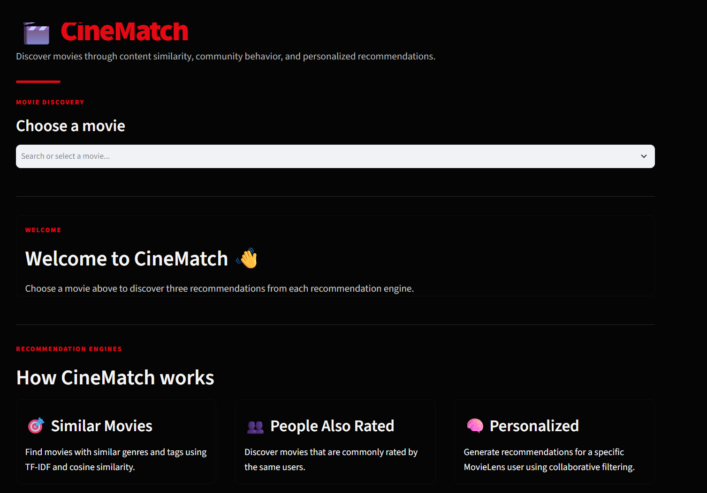
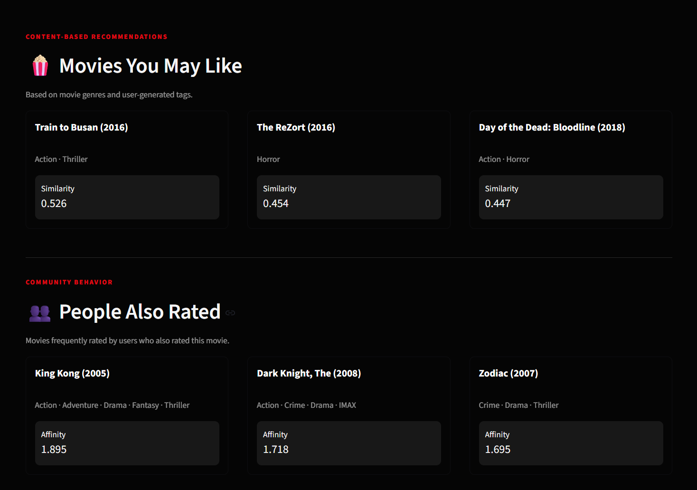
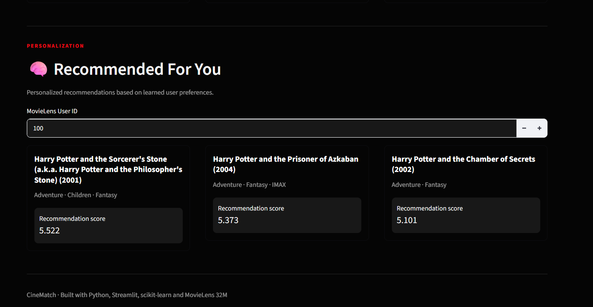

# CineMatch --- Movie Recommendation System

CineMatch is a machine-learning movie recommendation system built with
the **MovieLens 32M dataset**. The project combines content-based
filtering, collaborative filtering, movie co-rating behavior, and a
hybrid recommendation strategy.

The project was developed as a data-science portfolio project with a
focus on recommendation systems, sparse data processing, model
evaluation, and deployment with Streamlit.

## 🚀 Live Demo

[Demo Video]
## 📸 Application Preview

### Home Screen


### Recommendation Results


### Personalized Recommendations


## Features

-   Content-based movie recommendations
    -   Uses movie genres and user-generated tags.
    -   TF-IDF converts movie content into numerical vectors.
    -   Cosine similarity finds movies with similar content.
-   Personalized recommendations
    -   Uses collaborative filtering based on user-rating behavior.
    -   A truncated SVD model learns latent user and movie
        representations.
-   People Also Rated
    -   Uses movie-user co-rating patterns.
    -   Recommends movies that are frequently rated by users who also
        rated the selected movie.
-   Hybrid recommendation
    -   Combines content, collaborative, and behavioral signals.
    -   Initial weights:
        -   Content: 30%
        -   Collaborative filtering: 50%
        -   Also-rated: 20%
-   Streamlit application
    -   Searchable movie selection.
    -   Dark Netflix-inspired interface.
    -   Three recommendation sections.
    -   Maximum three movies displayed per section.

## Dataset

The project uses **MovieLens 32M** from GroupLens.

Main files:

-   `movies.csv`
-   `ratings.csv`
-   `tags.csv`
-   `links.csv`

Dataset scale used in the project:

-   87,585 movies
-   200,948 users
-   32,000,204 ratings
-   2,000,072 tag records

The processed collaborative-filtering dataset contains 29,542,223
ratings after applying iterative activity thresholds.

## Project Structure

``` text
Netflix Movie recomendation system/
│
├── data/
│   ├── raw/
│   │   └── ml-32m/
│   └── processed/
│
├── notebooks/
│   ├── 01_data_understanding.ipynb
│   ├── 02_exploratory_data_analysis.ipynb
│   ├── 03_data_preprocessing.ipynb
│   ├── 04_content_based_recommender.ipynb
│   ├── 05_collaborative_filtering.ipynb
│   ├── 06_also_watched_recommender.ipynb
│   ├── 07_hybrid_recommender.ipynb
│   └── 08_model_evaluation.ipynb
│
├── src/
│   ├── data_preprocessing.py
│   ├── content_recommender.py
│   ├── collaborative_recommender.py
│   ├── hybrid_recommender.py
│   └── evaluation.py
│
├── models/
├── app/
│   └── app.py
│
├── .gitignore
├── requirements.txt
├── README.md
└── report.md
```

## Recommendation Pipeline

``` text
MovieLens 32M
      │
      ▼
Data Understanding
      │
      ▼
Exploratory Data Analysis
      │
      ▼
Data Preprocessing
      │
      ├───────────────┐
      ▼               ▼
Content Model      Rating Data
TF-IDF             │
      │            ├───────────────┐
      ▼            ▼               ▼
Content        Collaborative   Also-Rated
Similarity       SVD             Model
      │            │               │
      └────────────┴───────┬───────┘
                           ▼
                    Hybrid Recommender
                           │
                           ▼
                     Model Evaluation
                           │
                           ▼
                    Streamlit Application
```

## Models

### 1. Content-Based Filtering

Movie genres and user-generated tags are combined into a content
representation.

TF-IDF configuration:

``` python
TfidfVectorizer(
    stop_words="english",
    ngram_range=(1, 2),
    min_df=2
)
```

The resulting TF-IDF matrix contains 87,585 movies and 248,779 features.

Cosine similarity is then used to identify similar movies.

### 2. Collaborative Filtering

A sparse user-movie rating matrix is constructed from the processed
ratings.

Truncated SVD with 50 latent factors is used to learn user and movie
representations.

The evaluation SVD explained approximately 34.8% of the variance.

### 3. Also-Rated Recommender

The system builds a sparse movie-user matrix and measures how strongly
movies are associated through shared users.

This represents **movies that users also rated**, rather than confirmed
watch history.

### 4. Hybrid Model

The hybrid model combines normalized recommendation scores:

``` text
Hybrid Score =
    0.30 × Content Score
  + 0.50 × Collaborative Score
  + 0.20 × Also-Rated Score
```

These weights are initial configuration values, not optimized
parameters.

## Evaluation

The evaluation uses a temporal leave-one-out protocol.

For each user:

1.  Ratings are ordered chronologically.
2.  The most recent rating is held out.
3.  Earlier ratings are used for training.
4.  A rating of 4.0 or higher is treated as a positive interaction.
5.  Top-10 recommendations are evaluated.

### Results

  Model                       Hit Rate@10   Precision@10   Recall@10   NDCG@10
  ------------------------- ------------- -------------- ----------- ---------
  Content-Based                     3.50%          0.35%       3.50%     1.82%
  Collaborative Filtering          10.12%          1.01%      10.12%     5.27%
  Hybrid                            9.26%          0.93%       9.26%     4.98%

Collaborative filtering performed best under the current evaluation
protocol. The hybrid model performed closely behind it.

## Installation

Clone the repository and create a Python environment:

``` bash
python -m venv venv
```

Activate it on Windows PowerShell:

``` powershell
venv\Scripts\Activate.ps1
```

Install dependencies:

``` bash
pip install -r requirements.txt
```

Place the MovieLens 32M dataset under:

``` text
data/raw/ml-32m/
```

## Run the Application

From the project root:

``` bash
streamlit run app/app.py
```

The application will open in the browser.

## Model Artifacts

The trained models and supporting artifacts include:

-   `tfidf_matrix.npz`
-   `tfidf_vectorizer.joblib`
-   `collaborative_svd.joblib`
-   `user_to_index.joblib`
-   `movie_to_index.joblib`
-   `user_ids.npy`
-   `movie_ids.npy`
-   `user_factors.npy`
-   `movie_user_matrix.npz`
-   `movie_ids_aw.npy`
-   `movie_to_index_aw.joblib`
-   `movie_user_counts.csv`
-   `hybrid_config.joblib`

## Limitations

-   MovieLens contains ratings and tags; it does not provide actual
    viewing logs.
-   Therefore, the "People Also Rated" signal should technically be
    interpreted as co-rating behavior.
-   The initial hybrid weights were manually selected rather than
    optimized.
-   The content-based model performs substantially below collaborative
    filtering under the current evaluation protocol.
-   The current personalized model is based on learned latent factors
    and does not yet use a lightweight user-rating-history artifact in
    the Streamlit application to exclude previously rated movies.
-   TMDB poster integration is intentionally not part of the current
    version.

## Future Improvements

-   Optimize hybrid weights using validation data.
-   Add a lightweight user-history lookup to exclude previously rated
    movies.
-   Add recommendation explanations.
-   Add movie posters and richer metadata.
-   Experiment with implicit-feedback recommendation algorithms.
-   Compare SVD with other collaborative-filtering approaches.
-   Add more rigorous offline evaluation and hyperparameter tuning.
-   Deploy the Streamlit application.

## Technologies

-   Python
-   Pandas
-   NumPy
-   SciPy
-   Scikit-learn
-   Joblib
-   Matplotlib
-   Seaborn
-   Streamlit
-   Jupyter Notebook

## Author
Mst Anarkoli
Data Science Portfolio Project --- CineMatch
